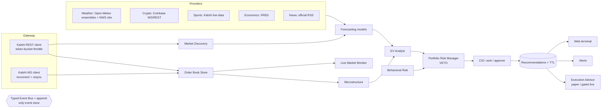

# Betting Intelligence OS — Technical Architecture

> Status: living document. Every claim about data sources reflects what is actually implemented and verified;
> see `docs/STATUS.md` for the verified/unverified ledger.

## 1. Goal

Continuously answer one question:

> *Is there a Kalshi contract available **right now** whose conservatively-estimated probability of winning
> exceeds the break-even probability implied by its **executable** price, fees and slippage, by enough to
> justify the risk?*

If not, the system says **NO QUALIFIED TRADE** — indefinitely if necessary.

## 2. Key verified facts about Kalshi (researched 2026-10-21)

| Topic | Fact | Design consequence |
|---|---|---|
| Prices | Fixed-point dollar strings, 4 dp (`"0.4500"`); quantities fixed-point 2 dp (`"10.00"`) | All money is `Decimal`; no floats |
| Price grid | Per-market `price_ranges` (e.g. 1¢ linear, or sub-penny near edges) | `PriceGrid` validates/snaps every limit price |
| Order book | REST/WS return **bids only** for YES and NO. YES ask = 1 − best NO bid | `OrderBook` derives asks from opposite bids |
| Public REST | Market data endpoints work unauthenticated (verified) | Engine runs in REST-poll mode without credentials, clearly labeled |
| WebSocket | Auth required at handshake, even for public channels | Streaming only when API key configured; otherwise status = `REST_POLL` |
| Auth | RSA-PSS SHA-256 signature over `timestamp_ms + METHOD + path` | `kalshi/auth.py` |
| Settlement — weather | e.g. KXHIGHNY settles on **The Weather Company** value for CLINYC (Central Park) | Model forecasts the station; basis vs. NWS/ensembles added to uncertainty |
| Settlement — BTC | KXBTCD settles on 60-second average of **CF Benchmarks BRTI** | Coinbase spot is a *proxy* (flagged); basis term added to σ |
| Combos | Many `KXMVE*` multivariate markets | Excluded from discovery (`mve_filter=exclude`) |
| Fees | Series `fee_type` (`quadratic`, `quadratic_with_maker_fees`, `flat`), `fee_multiplier`, event overrides | `fees.py` implements exact formula + rounding |

## 3. Component diagram

All agents communicate via the typed `EventBus` (`boi/events.py`). Decision-relevant events are persisted to
the append-only `events` table (forecast inputs, model versions, timestamps) so any recommendation can be replayed.

## 4. Process model

* **One always-on Python service** (`boi serve`): FastAPI + the asyncio engine (agents, feeds) in one process.
  A single process is deliberate: the local order books and freshness state are authoritative in memory and
  must not be split across processes without a broker. Headless mode: `boi engine`.
* **Storage:** SQLite (WAL) by default; Postgres via `DATABASE_URL` for hosted deployments.
* **Frontend:** Vite + React + TypeScript SPA, served statically by the API in production; live updates over SSE.
* **Deployment:** Dockerfile + compose; any always-on VM/container host (Fly.io, Cloud Run with min-instances=1,
  a home server). A browser tab is never the background worker.

## 5. Freshness & "LIVE" semantics

Every price carries: exchange timestamp (when supplied), local receipt time, transport (`ws`/`rest`), and the
feed's connection state. A book is **LIVE** only if its feed is connected and synchronized and its age is below
`max_market_data_age_sec` (WS) / `max_rest_book_age_sec` (REST). Otherwise it is **STALE** and every
recommendation depending on it is invalidated immediately. Sequence gaps on WS trigger a resubscribe/snapshot.

## 6. Forecasting

Models are per market type; no generic model is forced onto unrelated events.

| Model | Markets | Independence | Method |
|---|---|---|---|
| `weather_temp_v1` | KXHIGH*/KXLOW* | independent | Multi-model ensemble (GFS/ECMWF/ICON) kernel density + observed-extreme-so-far truncation for same-day markets; settlement rounding to integer °F |
| `crypto_threshold_v1` | KXBTCD/KXETHD/… | independent | Log-normal diffusion from spot proxy with EWMA realized vol, basis term, vol-uncertainty interval |
| `sports_inplay_v1` | KX*GAME winners | **market-informed** | Brownian-motion margin model (Stern 1994) anchored on recorded pregame price; requires fresh live game state |
| `market_baseline` | all | baseline | Mid-price; never trades — used as the benchmark every model must beat |

Each forecast emits `p_yes`, an uncertainty interval `[p_low, p_high]`, input data with source timestamps,
and its independence class. **Eligibility always uses the conservative bound** for the purchased side.

## 7. Signal → Recommendation pipeline

1. `EVAnalyst` walks the actual ask ladder for the risk-sized quantity, computes per-level fees, slippage buffer,
   gross/net/conservative EV, ROI, break-even probability, stress EV.
2. `Microstructure` vetoes on spread, depth, staleness, halted status.
3. `PortfolioRiskManager` (**veto**) sizes with fractional Kelly at the conservative probability and applies hard
   caps: per-trade, open risk, per-event, per-category, daily loss, drawdown halt, available cash. Stricter wins.
4. `BehavioralRisk` enforces cooldowns, daily trade count, and blocks size increases after losses.
5. `CIO` classifies (STRONG_CANDIDATE / CANDIDATE / WATCHLIST / NO_TRADE), ranks by conservative risk-adjusted
   EV (not probability of winning), and issues recommendations with a TTL and a **maximum entry price**.
6. Any book update that pushes the executable price above max entry, any feed staleness, or forecast change
   invalidates the recommendation immediately.

## 8. Execution modes

| Mode | Default | Behavior |
|---|---|---|
| `intelligence` | ✅ | Recommendations only |
| `paper` | | Simulated fills by walking the *live* book at submission + latency; partial fills; fees; separate ledger |
| `live` | ❌ | Requires `EXECUTION_MODE=live`, `LIVE_TRADING_ARMED=true`, exact confirmation phrase, credentials, passing validation gates, per-order preview + explicit approval via API with admin token, idempotent `client_order_id`, kill switch |

## 9. Security

Secrets only in env / key file; `.env` git-ignored; private key never leaves the server or appears in logs
(log redaction filter). State-changing API calls require `ADMIN_TOKEN` bearer auth. Orders are audit-logged with
idempotency keys.

## 10. Testing

Unit tests for money/grid, fees, EV, sizing, order-book derivation and sequence-gap handling, risk caps,
recommendation invalidation, paper fills, calibration metrics, auth signing. Live smoke tests (opt-in,
`BOI_LIVE_TESTS=1`) hit production public endpoints.
